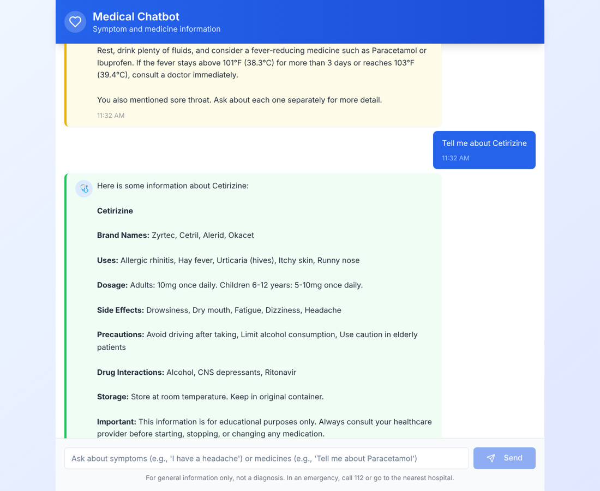

# Medical Chatbot

A browser-based chatbot that gives general information about common symptoms and over-the-counter medicines.

Team project by J Kowshik and K S Vinay Sathvik, completed in the first year of the B.E. in Artificial Intelligence and Machine Learning at B.N.M. Institute of Technology, Bengaluru.



## How it works

The chatbot is rule-based and runs entirely in the browser, with no model or server.

1. **Medicine lookup.** If the message names one of eight medicines (by generic or brand name, for example *Dolo* for paracetamol), the bot returns a structured card with uses, dosage, side effects, precautions, interactions and storage.
2. **Symptom rules.** Otherwise the message is matched against nine symptom groups, using whole-word matching so that "scold" does not trigger *cold*. Each rule has a severity (low, medium or high) shown as the colour of the reply.
3. **Several symptoms.** When a message mentions more than one symptom, the most severe one is answered first and the others are listed.

| File | Contents |
| --- | --- |
| `src/utils/medicalLogic.ts` | Symptom rules, matching and response selection |
| `src/utils/medicineDatabase.ts` | Medicine entries and name lookup |
| `src/utils/medicalLogic.test.ts` | Unit tests for matching and severity ordering |
| `src/components/` | Chat window, message bubbles and typing indicator |

## Running

```sh
npm install
npm run dev      # http://localhost:8080
npm test         # unit tests (Vitest)
npm run build
```

Built with React, TypeScript, Vite and Tailwind CSS. The interface was first scaffolded with Lovable and later trimmed to the components the app uses.

## Disclaimer

This is a student project for general information only. It does not diagnose conditions and is not a substitute for advice from a qualified doctor. In an emergency in India, call 112.
